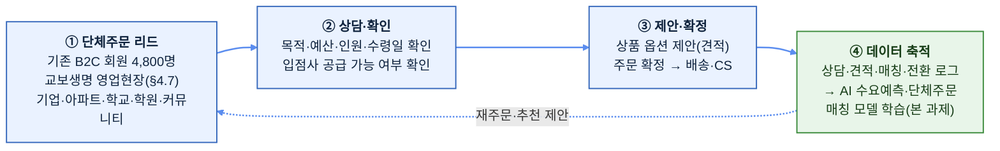

# 01. 사업 현황 및 트랙션 (PMF·데이터 해자 증빙)

> **요약**: 딸기로픽(딸기로컴퍼니의 B2C 서비스)은 2025년 8월 정식 론칭 후 약 8개월 누적으로 **가입 4,800명·GMV 1.1억원·디저트 17,116개 판매**를 기록하며, **첫 구매 전환율 49.5%·LTV/CAC 6.7배**라는 업계 최상위권 지표로 **PMF(Product-Market Fit)를 실증**했다. 이 실거래 트랙션은 (1) 본 TIPS 안건 1·2의 **데이터 해자**이자, (2) B2C의 구조적 한계(낮은 객단가)를 **B2B/B2B2C·AI 자동매칭으로 돌파**하는 스케일업 논리의 근거다. 그 확장 과정의 **B2B 단체주문 오픈베타 운영 구조(§4.5)와 수작업 병목(§4.6)** 이 "왜 이 R&D가 필요한가"의 운영 현장 증거다. → [00 개요](00_프로젝트개요.md) · [07 픽미 공동연구](07_픽미공동연구_분석방법론.md)

---

## 1. 왜 이 문서가 중요한가 (TIPS 관점)

TIPS 심사에서 기술성만큼 중요한 것이 **"이 팀이 실제로 시장을 뚫어낼 수 있는가"(사업화 실행력·트랙션)** 다. 딸기로컴퍼니는 아이디어 단계가 아니라 **이미 매출·재구매·충성 트래픽을 만들어내는 검증된 플랫폼**이며, 그 위에서 R&D를 얹는다. 본 문서의 실측 지표는 제안서 전반에서 다음을 뒷받침한다.

1. **PMF 증명** — 할인 프로모션 없이 첫 구매 전환율 49.5% (업계 3~4배). 특정 타깃(F&B/디저트)에 대한 압도적 적합성.
2. **데이터 해자** — 4,905건의 실결제·17,116개 판매 로그는 안건 1(트렌드)·안건 2(랭킹)의 학습·검증 데이터. 경쟁사가 살 수 없는 자산. → [04 인터넷 데이터](04_인터넷데이터_활용방법.md) · [07 픽미 공동연구](07_픽미공동연구_분석방법론.md)
3. **자본 효율** — LTV/CAC 6.7배(VC 합격선 3.0배의 2배 이상). 외부 자금을 태워 스케일업해도 자본 잠식 리스크가 낮다는 재무적 근거.
4. **R&D 당위성** — 낮은 객단가(AOV 2.28만원)라는 B2C의 구조적 약점을, 본 과제의 **AI 자동 큐레이션·수요예측·통합추천**으로 B2B/대량주문 시장을 열어 돌파한다(§4).

> 데이터 기간: **2025.08.04 서비스 론칭 ~ 2026.05.11 누적**(약 8개월). 출처: 자사 전체주문데이터 및 트래픽 분석.

---

## 2. 비즈니스 스케일 & 트래픽 현황

우리는 이미 다양한 디저트를 성공적으로 판매하는 저력 있는 플랫폼이며, 트래픽 측면에서도 메가 플랫폼으로 도약할 잠재 지표를 확인하고 있다.

| 지표 | 실측값 | 비고 |
|------|--------|------|
| 총 누적 가입 회원 | **4,800명** | |
| 총 방문수(8개월 누적) | **147,942건** | 일평균 약 608명 |
| 평균 MAU | **약 14,850명** | 기간 내 월 평균 추정 |
| 최고 MAU | **약 32,400명** | 2026년 3월 피크 |
| 최고 DAU | **2,055명** | 2026-03-09 / 2~3월 일 2천 명 돌파 다수 |
| 최고 일일 페이지뷰(PV) | **17,269건** | 2025-10-12 이벤트 기간 |
| 총 누적 결제금액(GMV) | **약 1억 1,187만원** | |
| 총 고유 결제 건수 | **4,905건** | 장바구니 결제 기준 |
| 총 판매 낱개 수량 | **17,116개** | 실제 팔린 디저트 개수 |

> 👉 지금까지 입점 빵집 사장님들의 디저트 **1만 7천여 개**를 판매하며 파트너사 매출에 직접 기여했다. 평시 MAU 1.5만 명을 유지하다 피크 시 **MAU 3.2만·DAU 2천**을 돌파한 것은, 우리 플랫폼의 **희소성 기반 드롭 마케팅**(주간 팝업·한시 판매)이 폭발적으로 작동함을 증명한다. → 큐레이션 커머스 모델 상세 §5.

---

## 3. 핵심 지표 벤치마크 (마케팅·CRM·유닛 이코노믹스)

큐레이션 모델의 강력함을 보여주는 동시에, 탑티어 커머스로 가기 위한 냉정한 과제도 함께 짚는다.

| 구분 (핵심 지표) | 🍓 딸기로픽 | 👗 버티컬 커머스 (에이블리 등) | 📦 메가 플랫폼 (쿠팡/컬리 등) | 🔍 진단 |
|---|---|---|---|---|
| **가입 대비 첫 구매 전환율** | **49.5%** | 15~20% | 30~40% | 업계 최상위권, PMF 검증 완료 (프로모션 無) |
| **신규 고객 획득 비용 (CAC)** | **6,996원** | 15,000~25,000원 | 30,000~50,000원+ | 경쟁사 대비 3~4배 저렴, 오가닉 유입 극대화 |
| **LTV / CAC 비율** | **6.7배** | 3.0배(합격선) | – | 압도적 자본 효율, 외부 자금 스케일업 적기 |
| **재방문율 / 재구매율** | **재방문 70.6% / 재구매 38.9%** | 재구매 45~50% | 재구매 70~80%+ | 트래픽 락인 강력, 결제 재구매율 상향이 과제 |
| **1회 평균 객단가 (AOV)** | **22,808원** | 30,000~40,000원 | 25,000~60,000원 | 🚨 **[시급 과제]** CVP 관점의 B2B 전환 필요 |

> 벤치마크 출처: 2023~2024년 Adjust/AppsFlyer 모바일 커머스 전환율 리포트, 각 사 보도자료·실적 발표, 증권사 이커머스 섹터 리포트, 국내 퍼포먼스 마케팅 에이전시 평균 CAC 지표 등.

### 3.1 유입·전환 (Acquisition & Conversion)

- **첫 구매 전환율 49.5%** (실구매 2,376명 / 회원 4,800명): 가입자 2명 중 1명이 구매. 에이블리·지그재그 등 탑티어 버티컬조차 15~20%인데, 이를 **할인 프로모션 없이** 달성한 것은 랜딩·큐레이션 파워의 강력한 증거다.
- **채널 구조**: 인스타그램(IG)이 약 45,000건 유입으로 신규 고객의 마중물, 결제 금액 기여의 **90%는 직접 유입·오가닉 검색**(네이버 25.7%·구글 4.2%·앱 등 기타 70%)에서 발생. IG로 인지 → 브랜드 직접 방문 → 충성 재방문 전환의 선순환.
- **SMS 리텐션**: 유입량은 적지만 구매 전환율 4.1%로 최고 효율 → 기존 재방문 고객의 지갑을 다시 여는 데 가장 강력한 채널.

### 3.2 자본 효율 (Marketing Efficiency & ROI)

- **CAC 6,996원** (총 마케팅비 1,662만원 / 신규 구매 2,376명): 1명 획득에 7천원이 안 든다는 것은 경쟁사 대비 3~4배 저렴한 획득 우위. 오가닉·직접 유입 90%가 혼합 획득단가(Blended CAC)를 극단적으로 낮춘다.
- **LTV/CAC 6.7배** (LTV 47,084원 / CAC 6,996원): 이커머스/SaaS 합격선 3.0배의 2배 이상. **신규 자금으로 마케팅 볼륨을 늘려 스케일업해도 자본 잠식 리스크가 낮다**는 재무적 근거.

### 3.3 유닛 이코노믹스 (Monetization) — 가장 시급한 과제

- **AOV 22,808원** (장바구니당 평균 2.94개 품목): 고객은 1회 결제 시 평균 3종의 디저트를 담는다. 다만 버티컬 커머스(3~4만원) 대비 낮아, 배송비·포장비·PG 수수료 등 변동비를 제하면 **첫 구매 공헌이익이 매우 타이트**하다. 규모의 경제 미실현 단계에서는 적자 구조가 될 수 있으며, 우리는 이를 명확히 인지한다.
- **재구매율 38.9%** (평균 구매 빈도 2.06회): 재방문 트래픽(70.6%)에 비해 결제 재구매(38.9%)가 낮다 = *"구경은 자주 오지만 매번 결제하지는 않는다"*. 탑티어의 코어 유저 재구매율(45~50%+)을 목표로 **"가끔 구경하는 앱 → 주기적으로 결제하는 필수 앱"** 진화가 필요.
- **LTV/ARPU**: ARPU(가입자당 매출) 23,306원, 실현 LTV(결제자 ARPPU) 47,084원. 재구매율을 고려하면 이 값은 시간이 지날수록 우상향한다.

> 🎯 **결론**: **B2C PMF는 검증됐으나, AOV 22,808원이라는 구조적 한계 때문에 B2B/B2B2C 대량주문 전환이 필요하다.** 획득 효율(CAC·LTV/CAC)은 최상위권으로 "마케팅을 해도 되는 비즈니스"임이 검증됐고, 병목은 낮은 객단가뿐이다. 이를 **B2B 자동매칭 플랫폼(고단가·대량주문)** 으로 구조 전환해 코스트를 줄이고 이익을 키우는 것이 본 TIPS 과제의 사업화 핵심 논리다(§4 — 오픈베타 §4.5, 병목→R&D §4.6).

---

## 4. 성장 히스토리 & Vision 2026 스케일업 (J-Curve)

### 4.1 성장 히스토리 (Status Check)

| 단계 | 기간 | 형태·성과 |
|------|------|-----------|
| **Phase 0. 가설 검증** | 2023~2024 | **교보생명 사내벤처.** 임직원 대상 테스트베드로 디저트 큐레이션·중개 모델 가능성 확인. |
| **Phase 1. 시장 진입·기반 구축** | 2025 | **법인 설립 + B2C 서비스 론칭(8월).** 인력 중심 수동 운영(Manual Ops)으로 시장성 검증 → 우수 실사용자 데이터 확보, **재구매율 30% 상회**, **신용보증기금 R&D 자금 3억 유치(12월)**. |
| **Phase 2. 스케일업(원년)** | 2026 | **B2B/B2B2C 단체주문 오픈베타 운영(§4.5) → 수작업 병목 확인(§4.6) → AI 자동매칭 개발(본 과제)**. 검증된 모델 위에 **신보 R&D + TIPS**를 성장 엔진으로 기하급수적 성장 실현. |

> 시사점: 시장 니즈는 확실하나, **수작업 운영 + B2C 중심 구조로는 폭발적 매출 확대에 물리적 한계**가 존재한다. 이 한계를 기술(R&D)로 돌파하는 것이 2026년 과제다.
>
> 🎯 **본 과제의 한 문장 정의**: *딸기로픽은 B2C에서 이미 PMF를 검증했으며, 이제 B2B/B2B2C 단체주문으로 확장하는 과정에서 발생하는 **수작업 상담·매칭·제안·일정조율 병목**을 **AI 트렌드 분석·수요예측·단체주문 매칭 기술**로 해결하려는 R&D 과제다.* — 기술([02](02_트렌드분석추천시스템_기획.md)·[03](03_자연어추천랭킹시스템_기획.md))·사업(§4)·운영(§4.5~4.6) 논리가 모두 이 문장으로 수렴한다.

### 4.2 2026 핵심 목표 — 비즈니스 볼륨의 퀀텀 점프

거래액(GMV)·매출 극대화를 위해 **고단가·대량 주문이 발생하는 B2B/B2B2C 시장으로 전장을 확대**하고, TIPS·신보 자금은 이 확장을 뒷받침할 **고성능 엔진(자체 플랫폼 + AI)** 구축에 투입한다.

- **목표 1 — 시장 다변화**: 소액·다건 B2C → 고액·대량 B2B/커뮤니티 공구(기업 간식·행사 답례품·아파트 입주민 공구). 객단가 높은 시장 선점으로 매출 규모 확대. (§3.3 AOV 과제의 직접 해법)
  - **초기 공략축(우선순위)**: ① **B2B 기업 간식**(정기·대량, 객단가 최상) → ② **교보생명 영업현장**(운영사 = 실증 채널, §4.7) → ③ **아파트·커뮤니티 공동주문**(하이퍼 로컬 공구) → ④ **B2C 예약·구독**(기존 트래픽의 재구매 전환). 초점 분산 없이 이 순서로 침투한다.
- **목표 2 — 유닛 이코노미 혁신**: 수동 매칭을 **AI 자동화**로 전환해 변동비(운영 인건비)를 통제, 매출이 늘수록 이익률이 급증하는 구조 완성.

### 4.3 2026 3대 실행 전략 (Strategic Pillars)

1. **B2B/커뮤니티 시장 침투**: 검증된 큐레이션 역량으로 기업·로컬 커뮤니티 락인. 기업 담당자의 업무(수요조사·정산) 대행 솔루션으로 진입장벽 구축. 강남·판교·동탄 등 구매력 높은 거점 아파트 중심 하이퍼 로컬 공구(게이미피케이션).
2. **독자 엔진 구축**: 대량 주문·복잡한 B2B 프로세스를 감당할 자체 시스템. **TIPS R&D 연계 — AI 기반 수요예측·자동 큐레이션(안건 1)** 으로 사람이 처리 불가능한 규모의 주문 매칭 수행. B2B 전용 결제(법인카드·후불제)·커뮤니티 공구(모임 성공 시 자동결제) 등 특화 기능.
3. **데이터 기반 선순환(Data Flywheel)**: 축적 데이터로 재구매 유도. 기업/커뮤니티에 다음 주 간식 메뉴를 먼저 제안(Outbound Sales 자동화) — **안건 2 자연어 추천·랭킹 엔진**과 직결. 선호·위치 데이터를 결합한 타깃 팝업 알림.

### 4.4 2026 실행 로드맵 (Milestone)

| 시점 | 마일스톤 |
|------|----------|
| 2025.12 | [재원 확보] 신보 R&D 자금 유치 + 스케일업 전략 수립 |
| 2026 1분기 | [TIPS 착수 & B2B 파일럿] TIPS 과제 협약, B2B 전용 서비스(베타)로 초기 레퍼런스 확보 |
| 2026 2분기 | [독자 플랫폼 오픈] 대량 주문·공구 기능 자체 플랫폼 론칭, 기존 임대몰 데이터 이관 |
| 2026 3분기 | [시장 확장 가속] 거점 지역 공격 마케팅, **B2B 정기 계약 100건** 달성 목표 |
| 2026 4분기 | [AI 고도화 & 수익화] AI 자동 매칭 전면 도입, 월 손익분기점(BEP) 달성 도전 |

### 4.5 B2B/B2B2C 단체주문 오픈베타 — 운영 구조 (B2C 실증의 "다음 단계")

B2C PMF 검증 이후의 다음 단계는 곧바로 자동화 시스템을 만드는 것이 아니라, **단체주문 수요·공급 가능성을 수작업으로 먼저 검증하는 오픈베타**다. 이 운영 자체가 본 과제 AI의 학습데이터를 만든다.

> 💡 **핵심**: *초기에는 수작업으로 단체주문 수요와 공급 가능성을 검증하고, 이 과정의 상담·견적·전환 데이터를 R&D 학습데이터로 축적한다.* 오픈베타 로그(상담·견적·입점사 수락/거절·주문 전환)는 인터넷 공개 데이터가 줄 수 없는 **B2B 정답(label) 데이터**로, 안건 1·2 파이프라인의 자사 학습 소스에 직접 들어간다([02 §3](02_트렌드분석추천시스템_기획.md)·[04 §1](04_인터넷데이터_활용방법.md)).

### 4.6 수작업 단체주문 매칭 병목 — R&D 필요성의 실체

오픈베타의 전 과정이 현재 수작업이며, **각 병목이 곧 본 과제가 개발할 R&D 기술과 1:1로 대응**한다. "왜 이 R&D가 필요한가"에 대한 운영 현장의 답이다.

| 현재 수작업 단계 | 발생하는 병목 | 필요한 R&D 기술 (안건 연결) |
|------------------|---------------|------------------------------|
| 고객 상담 | 목적·예산·인원·수령일·배송지가 비정형(전화·카톡·메일)으로 유입 | **자연어 요청조건 구조화**(슬롯 추출) — [03 §5.1](03_자연어추천랭킹시스템_기획.md) |
| 입점사 확인 | 생산량·MOQ·리드타임·포장 조건이 업체마다 파편화 | **공급자 제약(Capacity) DB** — [03 §4.3](03_자연어추천랭킹시스템_기획.md) |
| 상품 추천 | 담당자 개인 경험·기억에 의존 | **매칭·랭킹 모델** — [03 §6](03_자연어추천랭킹시스템_기획.md) |
| 제안자료 작성 | 상품소개·옵션비교·견적 문구를 매번 수작업 작성 | **LLM 기반 제안자료 자동화** — [03 §6.1](03_자연어추천랭킹시스템_기획.md) |
| 일정 조율 | 고객 희망일 ↔ 입점사 생산 가능일 불일치 | **수요·공급 일정 매칭** — [03 §6](03_자연어추천랭킹시스템_기획.md) + 수요예측([02](02_트렌드분석추천시스템_기획.md)) |
| 주문 전환 | 선택·거절 사유가 데이터화되지 않음 | **전환 로그 학습(LTR)** — [03 §6.4](03_자연어추천랭킹시스템_기획.md) |

> 💡 **핵심**: *수작업으로 검증된 단체주문 프로세스를 AI 수요예측·매칭·제안 자동화 기술로 확장한다.* 사람이 하던 일을 그대로 자동화하는 게 아니라, **사람으로는 규모가 안 나오는 병목**(상담 동시처리·전국 공급자 대조·견적 리드타임)을 기술로 푸는 것이 R&D의 대상이다.

### 4.7 운영사(교보생명) = B2B/B2B2C 실증 채널

교보생명은 단순 투자·운영사가 아니라, **B2B/B2B2C 단체주문 모델을 실증하는 초기 테스트베드이자 R&D 학습데이터 확보 채널**이다(Phase 0 사내벤처 출신이라 조직 접점이 이미 있다 — §4.1).

| 활용 장면 | 설명 |
|-----------|------|
| 지점 간식 | 지점 회의·교육·시책 운영 시 정기 간식 수요 |
| 보험설계사 활동용품 | 고객 방문 시 전달하는 프리미엄 디저트·답례품 |
| 고객 방문 선물 | 상담 완료·우수고객 방문·기념일 선물 |
| 영업관리자 시책 | 설계사 독려·우수 설계사 리워드·조직 활성화 상품 |
| 교보 전용 페이지 | 영업현장 전용 단체주문/활동용품 신청 페이지 운영 |
| 데이터 수집 | 목적·예산·수량·지역·재주문 여부 등 **B2B 학습데이터 확보** |

> 운영사 지원을 "자금+네트워크"가 아니라 **"실증 채널 제공"** 으로 활용한다 — 전국 지점·설계사 조직이 곧 단체주문 수요의 반복 발생처이며, 오픈베타(§4.5) 리드의 핵심 공급원이다.

### 4.8 사업화 목표 산정 — B2C/B2B 분리 매출 산식

매출 목표는 단일 산식이 아니라 **사업 축별로 분리**해 산정한다(각 축의 드라이버가 다르므로).

| 매출 축 | 산식 | 드라이버 |
|---------|------|----------|
| **B2C 커머스** | 주문 수 × AOV(실측 22,808원) × 수수료율 | 트래픽·재구매율(38.9%→45%+) — 안건 2 추천이 개선 |
| **B2B 단체주문** | 단체주문 건수 × 평균 주문금액(B2C AOV의 수~수십 배) × 수수료율 | 오픈베타→AI 매칭 전환율·견적 리드타임 — 본 과제가 개선 |
| **정기 간식 구독** | 구독 계약 수 × 월 구독액 | 기업·커뮤니티 락인(§4.3), 2026 3Q 정기계약 100건 목표 |
| **데이터·SaaS(후속)** | 입점사 트렌드 리포트 구독 + 추천 엔진 SaaS/API 이용료 | 안건 1·2 엔진의 외부 판매([02·03 §10.3]) |

> 구체 수치·연차별 목표는 제안서 양식(사업화 목표표)에서 최신 실측으로 확정한다. 핵심은 **B2B 축의 평균 주문금액이 B2C AOV 한계(§3.3)를 구조적으로 우회**한다는 점이다.

---

## 5. 큐레이션 커머스 모델 (수익 기반의 성격)

딸기로픽의 핵심 BM은 **큐레이션 커머스(Curation Commerce)** 이며, 전개 방식은 **단계적 성장 전략(Phased Growth)** 이다 — 리스크를 최소화해 안정적으로 진입한 뒤 규모의 경제를 실현한다.

- **Phase 1(론칭 초기) — 집중화·브랜드 정체성**: 전문적 안목으로 3~4개 소수 브랜드를 엄선(딸기로픽의 선택=신뢰). **희소성 마케팅(주간 팝업)·드롭 마케팅(정시 공개)** 으로 즉각 구매·재방문 유도, 초기 팬덤 형성. 린 스타트업(MVP)으로 데이터 기반 학습.
- **Phase 2(성장기) — 구색 확장·매출 규모 증대**: 검증된 모델 위에 취급 브랜드 수를 늘리고, '쨈 전문'·'버터 전문' 등 **테마별 멀티 팝업**을 동시 운영해 세그먼트를 다각 공략. 입점·고객 기반 확대로 규모의 경제 실현.

> 이 큐레이션 역량(무엇을·언제·누구에게 제안할지)이 곧 **안건 1(트렌드 조기 포착)·안건 2(자연어 랭킹 추천)** 가 자동화·고도화하려는 대상이다. 사람의 안목으로 검증된 큐레이션을 **AI로 규모화**하는 것이 본 R&D의 본질이다.

---

## 6. 본 TIPS 과제와의 연결 (요약)

| 실측 트랙션 | 뒷받침하는 제안서 논리 |
|-------------|------------------------|
| 전환율 49.5%·재방문 70.6% | **PMF·큐레이션 파워** — 안건 1·2가 자동화할 검증된 큐레이션 역량 ([02](02_트렌드분석추천시스템_기획.md)·[03](03_자연어추천랭킹시스템_기획.md)) |
| GMV 1.1억·결제 4,905건·판매 17,116개 | **데이터 해자** — 안건 1·2 학습/검증 데이터 ([04](04_인터넷데이터_활용방법.md)·[07](07_픽미공동연구_분석방법론.md)) |
| LTV/CAC 6.7배·CAC 6,996원 | **자본 효율·스케일업 적기** — TIPS·신보 자금 투입의 재무 근거 ([05 비용가이드](05_비용가이드.md)) |
| AOV 2.28만원(과제)·재구매 38.9% | **R&D 당위성** — B2B/대량주문 AI 자동매칭으로 객단가·수익성 돌파 (§4, [02 §10.3](02_트렌드분석추천시스템_기획.md)) |
| B2B 오픈베타 수작업 병목 6종 (§4.6) | **R&D 필요성의 운영 증거** — 병목 각각이 안건 1·2 개발 기술과 1:1 대응, 오픈베타 로그 = B2B 학습데이터 ([03 §4.3](03_자연어추천랭킹시스템_기획.md)) |
| Phase 0~1 검증 → 2026 스케일업 | **실행력·로드맵** — 사내벤처 검증→법인→신보 3억→TIPS의 일관된 성장 서사 + 교보생명 실증 채널(§4.7) |

> ⚠️ 위 수치는 특정 기간(2025.08~2026.05) 자사 실측/추정치다. 제안서 제출 시점 최신 데이터로 재확인·업데이트해야 한다.
